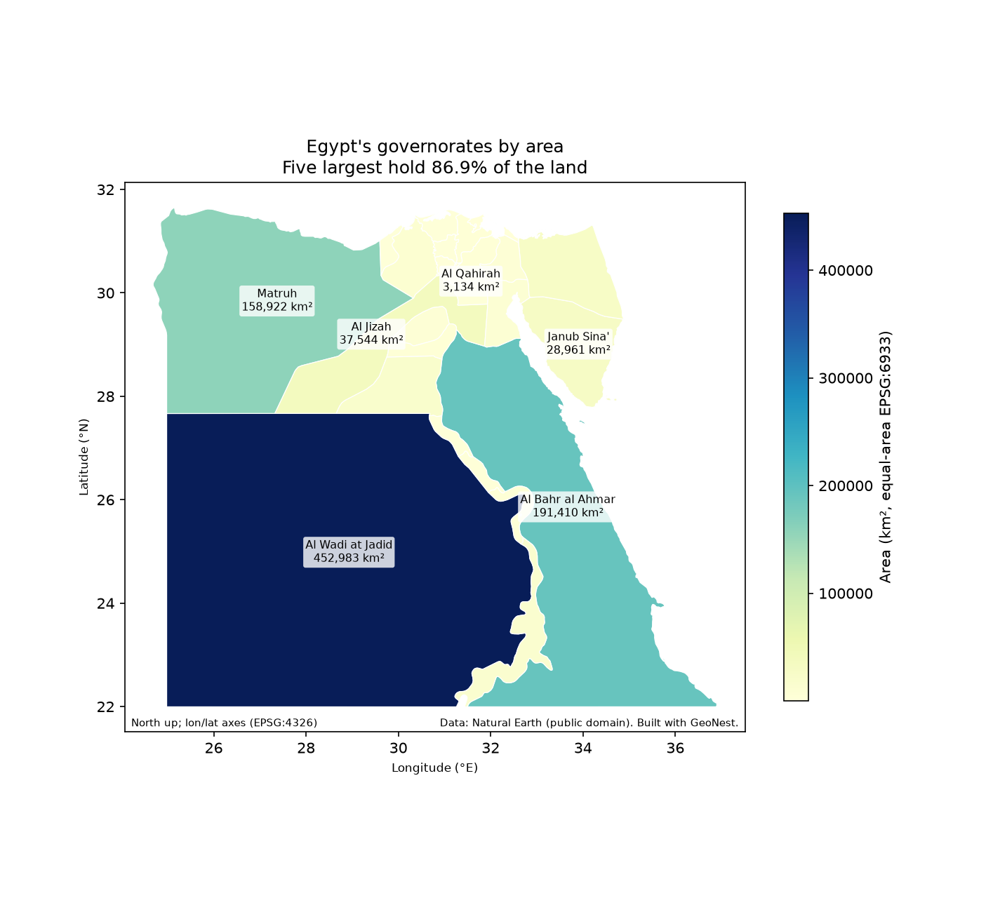

<p align="center">
  <picture>
    <source media="(prefers-color-scheme: dark)" srcset="assets/brand/logo-dark.svg">
    
  </picture>
</p>

# GeoNest 🗺️

**GeoNest** is a lightweight, Pythonic mapping library built on top of [ipyleaflet](https://github.com/jupyter-widgets/ipyleaflet) to simplify interactive geospatial visualization in Jupyter environments.

[](https://pypi.org/project/geonest/)
[](https://pypi.org/project/geonest/)
[](./LICENSE)

---

## ✨ Features

- **Simple API** — Clean `Map` class extending `ipyleaflet.Map` with intuitive methods
- **Basemap Support** — Built-in support for OSM, Esri, CartoDB, and Google basemaps
- **Vector Data** — Load GeoJSON, Shapefiles, and GeoDataFrames with one line
- **Raster Support** — Visualize GeoTIFFs using localtileserver
- **Media Overlays** — Add images and videos to your maps
- **WMS Layers** — Connect to Web Map Services easily
- **Interactive Widgets** — Basemap selector GUI and layer controls

---

## 🚀 Installation

### From GitHub (recommended for now)

```bash
pip install git+https://github.com/AmmarYasser455/GeoNest
```

> **Note:** the `geonest` 0.1.0 package on PyPI has a packaging bug: `from geonest import Map` fails with `ModuleNotFoundError`. Install from GitHub until the next PyPI release.

### From PyPI

```bash
pip install geonest
```

### From source

```bash
git clone https://github.com/AmmarYasser455/GeoNest.git
cd GeoNest
pip install -e .
```

### Development installation

```bash
pip install -e ".[dev]"
```

---

## 📖 Quick Start

```python
from geonest import Map

# Create a map centered on Cairo
m = Map(center=[30.0, 31.0], zoom=6)

# Add a basemap
m.add_basemap("OpenTopoMap")

# Display the map (in Jupyter)
m
```

### Add Vector Data

```python
# From a file
m.add_geojson("/path/to/data.geojson")

# From a GeoDataFrame
import geopandas as gpd
gdf = gpd.read_file("/path/to/shapefile.shp")
m.add_gdf(gdf)
```

### Add Raster Data

```python
m.add_raster("/path/to/satellite.tif", indexes=[4, 3, 2])
```

### Interactive Basemap Selector

```python
m.add_basemap_gui()
m.add_layer_control()
m
```

### Google Maps

```python
m.add_google_map("SATELLITE")
```

---

## 🖼️ Showcase

Egypt's governorates by area, built from Natural Earth data with `Map.add_gdf`:



See [showcase/](showcase/) for the report, the [web map](showcase/index.html), the [notebook](showcase/showcase.ipynb) and the [GeoJSON](showcase/map.geojson).

## 📚 API Reference

### `Map` Class

| Method | Description |
|--------|-------------|
| `add_basemap(name)` | Add a basemap by name (e.g., "OpenTopoMap", "Esri.WorldImagery") |
| `add_basemap_gui()` | Add an interactive basemap dropdown selector |
| `add_google_map(type)` | Add Google Maps tiles (ROADMAP, SATELLITE, HYBRID, TERRAIN) |
| `add_geojson(data)` | Add GeoJSON from file path or dict |
| `add_gdf(gdf)` | Add a GeoDataFrame |
| `add_vector(data)` | Add vector data (auto-detects type) |
| `add_raster(path)` | Add a raster layer using localtileserver |
| `add_image(url, bounds)` | Add an image overlay |
| `add_video(url, bounds)` | Add a video overlay |
| `add_wms_layer(url, layers)` | Add a WMS layer |
| `add_widget(widget)` | Add a custom ipywidgets widget |
| `add_layer_control()` | Add a layer visibility control |

---

## 🛠️ Development

### Running Tests

```bash
pytest tests/ -v
```

### Code Quality

```bash
# Lint and format check
ruff check .

# Auto-fix issues
ruff check . --fix
```

---

## 📁 Project Structure

```
GeoNest/
├── geonest/
│   ├── __init__.py      # Package exports
│   └── map.py           # Core Map class
├── example/
│   ├── intro.ipynb      # Getting started
│   ├── map.ipynb        # Map features demo
│   ├── raster.ipynb     # Raster & media demo
│   └── split_map.ipynb  # Split map control
├── tests/
│   └── test_map.py      # Unit tests
├── pyproject.toml       # Project configuration
├── requirements.txt     # Dependencies
└── README.md
```

---

## 🤝 Contributing

Contributions are welcome! Please feel free to submit a Pull Request.

1. Fork the repository
2. Create your feature branch (`git checkout -b feature/amazing-feature`)
3. Commit your changes (`git commit -m 'Add amazing feature'`)
4. Push to the branch (`git push origin feature/amazing-feature`)
5. Open a Pull Request

---

## 📄 License

This project is licensed under the MIT License - see the [LICENSE](./LICENSE) file for details.

---

## 👤 Author

**Ammar Yasser Abdalazim**

- GitHub: [@AmmarYasser455](https://github.com/AmmarYasser455)
- Email: ammaryasr522@gmail.com
