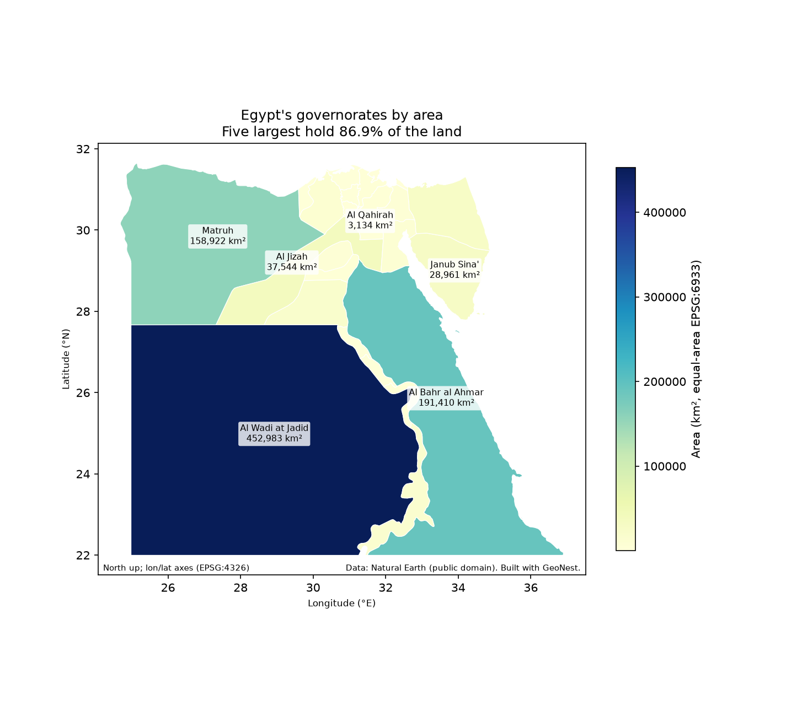

# Egypt's governorates by area, prepared with GeoNest

## Question

Which Egyptian governorates cover the most land, and what share of the country do the five largest hold?

## Data

- Natural Earth 1:10m Admin 1 – States, Provinces (`ne_10m_admin_1_states_provinces`), filtered to Egypt (27 governorates).
- Source: https://github.com/nvkelso/natural-earth-vector/blob/master/geojson/ne_10m_admin_1_states_provinces.geojson (project site: https://www.naturalearthdata.com/)
- License: public domain (Natural Earth terms of use).
- Date fetched: 2026-11-13. Saved as `data/egypt_governorates.geojson` (about 107 KB, attributes `name`, `name_en`, `iso_3166_2`, `type_en`, `adm0_a3`; geometry unchanged).
- The boundaries are generalised at 1:10m, so very small governorates (for example Luxor) are approximate.

## Method

1. Read the polygons with GeoPandas (EPSG:4326, lon/lat in degrees).
2. Reproject to EPSG:6933 (equal-area, metres) and compute each polygon's area in km², its share of the national total and its rank. Areas are never computed on degrees.
3. Pass the result to `geonest.Map.add_gdf`, which converts to EPSG:4326 and builds the GeoJSON layer; the layer data is written to `map.geojson` (RFC 7946 lon/lat, rings re-oriented counter-clockwise for exteriors).
4. Draw `map.png` with matplotlib and `index.html` with Leaflet.

## Results

- The 27 governorates sum to about 1,001,078 km² (Egypt is about 1.0 million km²).
- New Valley (Al Wadi at Jadid) is the largest: 452,983 km², 45.25% of the total.
- Red Sea (191,410 km², 19.12%) and Matruh (158,922 km², 15.88%) follow.
- The five largest (New Valley, Red Sea, Matruh, Giza, South Sinai) cover 869,821 km², 86.9% of the total.
- Cairo covers 3,134 km² (0.31%, rank 18) and Alexandria 2,305 km² (0.23%, rank 21).



## Links

- Web map: [index.html](index.html) (it loads `map.geojson`, so serve the folder, e.g. `python -m http.server` in `showcase/`, rather than opening the file directly)
- Notebook: [showcase.ipynb](showcase.ipynb)
- GeoJSON: [map.geojson](map.geojson)

## Rebuild

```bash
python showcase/make_showcase.py
```

It runs offline from `data/`. The notebook is re-executed with `python -m jupyter nbconvert --to notebook --execute --inplace showcase/showcase.ipynb`. `fetch_data.py` is the one-off download of the input and is not needed to rebuild.

Map tiles in the web map: © OpenStreetMap contributors.
